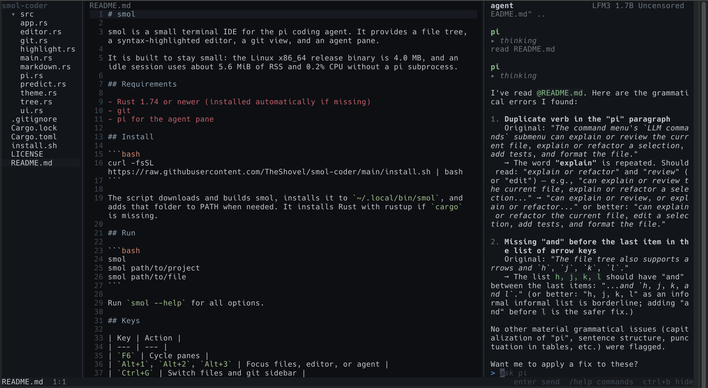

# smol

smol is a small terminal IDE for the pi coding agent. It provides a file tree, a syntax-highlighted editor, a git view, and an agent pane.



It is built to stay small: the Linux x86_64 release binary is 4.1 MB, and an idle session uses about 5.9 MiB of RSS and 0.2% CPU without a pi subprocess.

## Requirements

- Rust 1.74 or newer (installed automatically if missing)
- git
- pi for the agent pane

## Install

```bash
curl -fsSL https://raw.githubusercontent.com/TheShovel/smol-coder/main/install.sh | bash
```

The script downloads and builds smol, installs it to `~/.local/bin/smol`, and adds that folder to PATH when needed. It installs Rust with rustup if `cargo` is missing.

## Run

```bash
smol
smol path/to/project
smol path/to/file
```

Run `smol --help` for all options.

## Keys

| Key | Action |
| --- | --- |
| `F6` | Cycle panes |
| `Alt+1`, `Alt+2`, `Alt+3` | Focus files, editor, or agent |
| `Ctrl+G` | Switch files and git sidebar |
| `Ctrl+B` | Hide or show the agent pane |
| `Ctrl+S` | Save |
| `Ctrl+Z` | Undo |
| `Ctrl+Q` | Quit |
| `Ctrl+C` | Copy selection |
| `Ctrl+N` | Next file |
| `Ctrl+P` | Command menu and settings |
| `Ctrl+W` | Close file |
| `Ctrl+Left`, `Ctrl+Right` | Move by word |
| `Ctrl+Home`, `Ctrl+End` | Start or end of file |
| `Shift+arrows` | Select text |
| `Tab` | Accept a prediction or @ file suggestion, or indent |
| `BackTab` | Dedent |
| `Enter` | Open a file or diff, send a prompt, or commit |
| `Esc` | Stop the agent, close a diff, or leave the git input |

The file tree also supports arrows and `h`, `j`, `k`, `l`. It refreshes automatically when files and folders change. Click files and folders, drag pane dividers to resize, and drag in the editor to select text. Copy uses the terminal's OSC 52 clipboard support.

Type `@` in the agent input to reference a project file. A list filters paths as you type; use Up/Down and Tab or Enter to insert one.

The command menu groups actions into `Files`, `Settings`, `LLM commands`, and `Git` submenus.

## pi

smol starts pi as a subprocess in the project folder:

```bash
pi --mode rpc --no-session
```

pi manages authentication, models, and sessions. If it is missing, the agent pane links to its installer. Type `/help` in the agent input for available commands. The command menu's `LLM commands` submenu can explain or review the current file, explain or refactor a selection, add tests, and format the file. Commands that edit a file require it to be saved first.

smol checks context usage after each run and compacts automatically at 95%. pi's built-in auto-compaction is disabled so smol controls the threshold; `/compact` still compacts manually.

Agent reads and edits are highlighted in the editor. The editor follows the active file unless you have unsaved changes there.

## Git

The git sidebar shows changed files. Click a change to open its diff in the editor.

| Key | Action |
| --- | --- |
| `c` | Write a commit message |
| `p` | Push |
| `d` | Discard, press twice to confirm |
| `r` | Refresh |
| `o` | Open the selected file |

Commits stage all changes. Diffs open in the editor and support keyboard and mouse scrolling.

## Editing

Inline predictions are learned from open files and accepted lines, and are stored in `~/.cache/smol/predictions.txt`.

Binary files and files over 4 MB are not opened in the editor. Unsupported files show a button to open them with the system default application.

## Development

```bash
cargo build
cargo test
cargo run -- --force-no-pi
```

## Uninstall

```bash
rm ~/.local/bin/smol
rm -rf ~/.cache/smol
```

Remove the `# smol path` block from your shell startup file if the installer added it.
